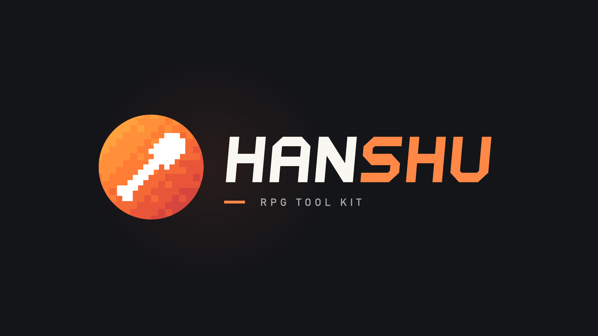

# HanShu RPG Tool Kit · 品牌素材包

本包为已确认的「纯白铲子 + 像素渐变圆底 + B 版字标」版本。

## 快速使用

- 软件图标、头像：使用 `icon/hanshu-icon.svg`，或相应尺寸的 PNG。
- 深色背景的横版标志：使用 `logo/hanshu-logo-dark.svg` 或同名 PNG。
- 浅色背景的横版标志：使用 `logo/hanshu-logo-light.svg` 或同名 PNG。
- 只需要 HANSHU 字样：使用 `logo/hanshu-wordmark.svg` 或同名 PNG，适合深色背景。
- 交互预览：用浏览器打开 `animation/HanShu-motion.html`，离线可用。
- 播放或剪辑视频：使用 `animation/mp4/` 中的 MP4。

## 文件说明

| 目录 / 文件 | 内容 |
| --- | --- |
| `icon/hanshu-icon.svg` | 可缩放的圆形图标 |
| `icon/hanshu-icon-{尺寸}.png` | 64、128、256、512、1024 像素的透明背景图标 |
| `logo/hanshu-logo-dark.svg` | 深色背景适用，HAN 为暖白色、SHU 为橙色，含 RPG TOOL KIT 副标题 |
| `logo/hanshu-logo-light.svg` | 浅色背景适用，HAN 为深灰色、SHU 为橙红色，含副标题 |
| `logo/hanshu-wordmark.svg` | 独立 B 版双色 HANSHU 字标 |
| `logo/hanshu-logo-dark.png` / `hanshu-logo-light.png` | 宽 1920 像素的透明背景横版标志 |
| `logo/hanshu-wordmark.png` | 宽 1200 像素的透明背景字标 |
| `animation/HanShu-motion.html` | 包含三套动画与播放控制的独立 HTML |
| `animation/mp4/` | 完整动画与三个独立片段 |
| `preview.png` | 深色背景的整体预览，1920×1080 |

`dark` 和 `light` 指适用的背景颜色；SVG 和对应 PNG 本身不带矩形底色。Icon 的橙色圆底属于图形，圆形外透明。所有 SVG 的字形均已转为路径，无需安装字体。

## 动画

| MP4 文件 | 内容 | 时长 |
| --- | --- | --- |
| `HanShu-motion.mp4` | 汇聚 → 涟漪 → 散场，完整串联 | 14 秒 |
| `HanShu-01-intro.mp4` | 像素汇聚、剪影浮现、字标入场 | 5.6 秒 |
| `HanShu-02-ambient.mp4` | 仅圆底的像素亮度形成涟漪，可循环 | 4.8 秒 |
| `HanShu-03-outro.mp4` | 字标、剪影与像素依次退场 | 3.6 秒 |

MP4 统一为 **1920×1080、60 fps、H.264 / yuv420p、深色背景、无音轨**。视频只包含标志与背景，不含网页控件；MP4 不含透明通道。

HTML 的 SVG、样式和动画脚本全部内联，无外部字体或网络依赖。支持播放/暂停、重播、拖动时间轴、0.5–2 倍速、循环以及深浅背景切换。空格键播放/暂停，R 键重播（焦点在输入控件上时优先操作控件）。启用系统「减少动态」偏好时，默认显示静态标志，仍可主动播放。

## 设计约定

- 铲子保持原始剪影，完整纯白 `#FFFFFF`；不拆分轮廓，不添加切面。
- 圆底以 16×16 像素格、8 个暖色色阶构成渐变。
- 色板由亮至暗：`#FFB247`、`#FFA13E`、`#FF9039`、`#FF7C35`、`#F56936`、`#E95538`、`#D7463E`、`#C63B47`。
- 保持图形和字标的原始比例；小尺寸优先使用独立 Icon。

SVG 与 HTML 可直接编辑。本包仅收录当前确认版素材，不含旧方案、渲染依赖或临时文件。
